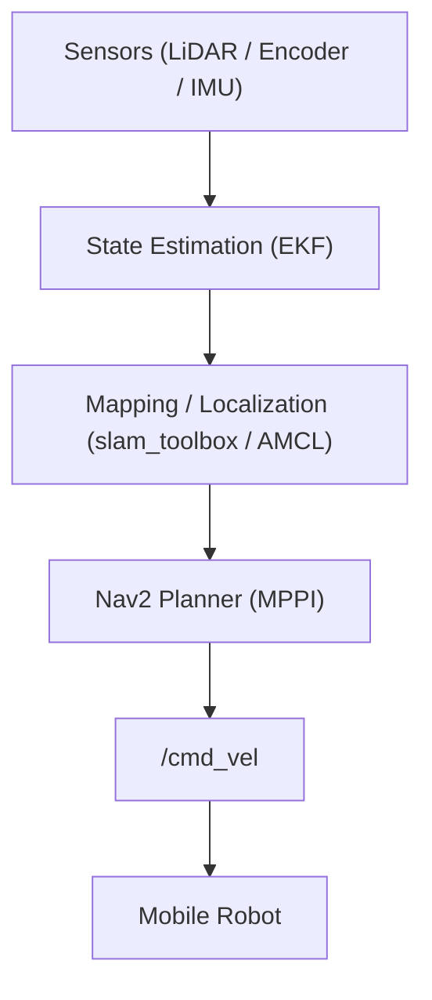
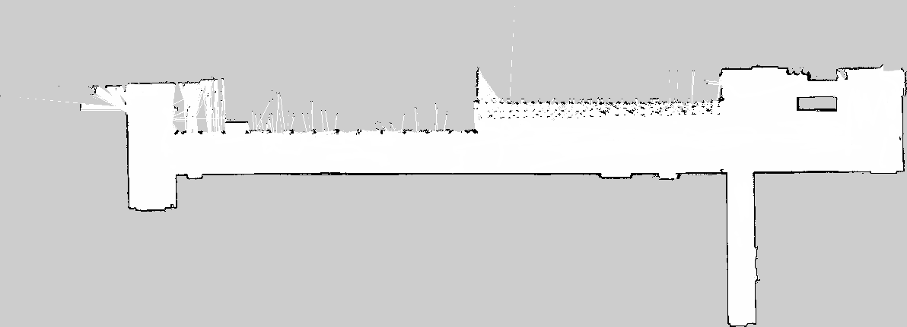
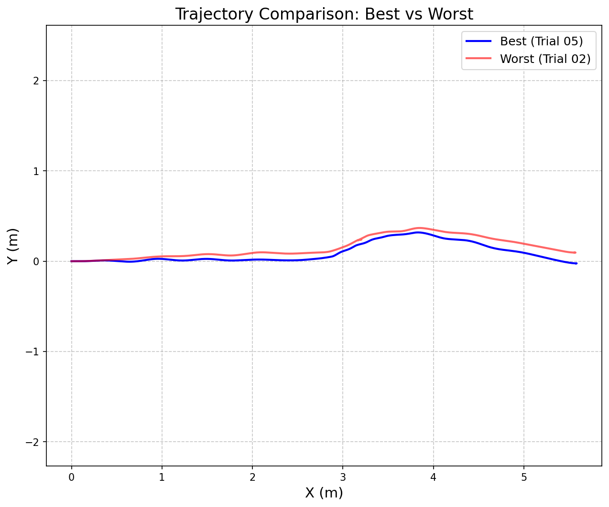
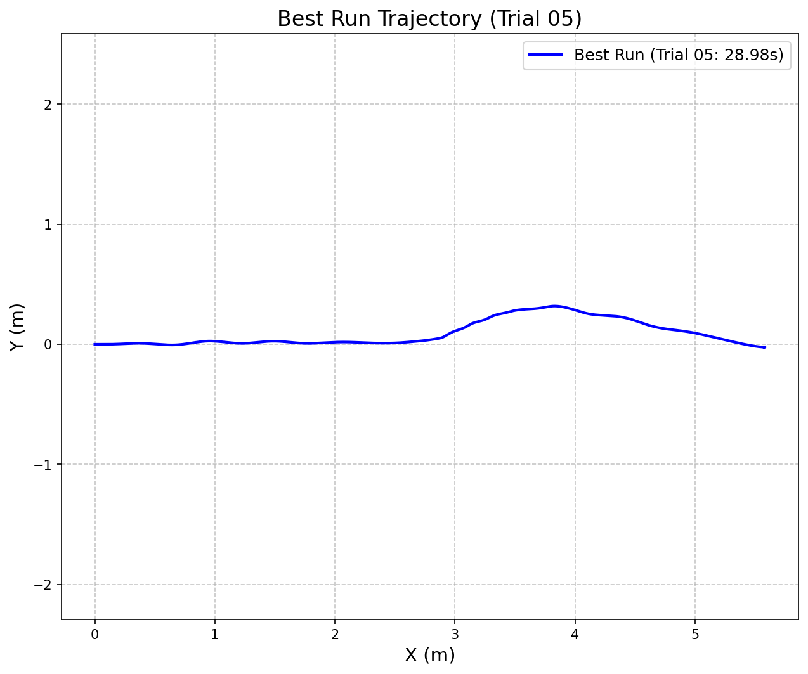
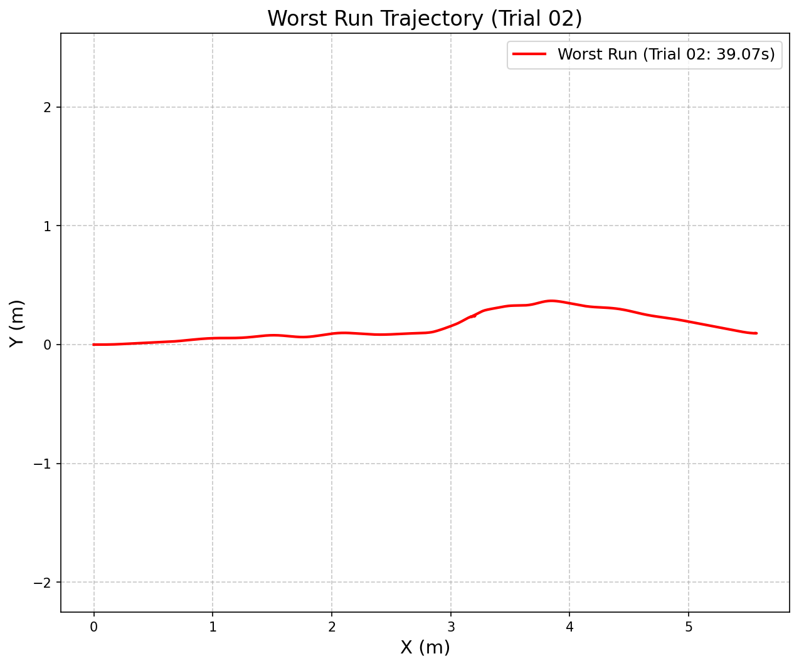

# Autonomous Security & Patrol Robot — ROS 2 + Nav2

An autonomous indoor patrol robot built on ROS 2 Nav2, covering the full pipeline from SLAM mapping and EKF-based odometry/sensor fusion with AMCL map localization to waypoint patrol and real-time person-following — implemented and tested on real hardware.

---

## Demo

**MPPI — obstacle avoidance in the recorded trial**

https://github.com/user-attachments/assets/f9c3c259-7703-4743-8fe3-fea5d009ca3b

**DWB — blocked in the recorded trial**

https://github.com/user-attachments/assets/b387b12d-7978-4542-97ea-095fd69b85d6

---

## Features

- **End-to-End autonomous pipeline** — SLAM → Localization → Waypoint patrol on real hardware
- **Sensor fusion** — 2D LiDAR + Wheel Odometry + IMU via EKF (`robot_localization`)
- **MPPI local planner** — migrated from DWB after navigation issues observed on this robot; tuned for the tested setup
- **Ping-pong waypoint patrol** — JSON-based waypoint list received from GUI; robot traverses forward and backward repeatedly
- **Person tracking mode** — on detection, Nav2 is preempted and the robot follows the person using a P-controller via RealSense depth data; automatically resumes patrol when the person disappears
- **Camera trigger** — publishes a capture trigger on arrival at each waypoint; waits for confirmation before moving to the next
- **Keepout zone** — costmap filter mask prevents the robot from entering restricted areas

---

## System Architecture

**Hardware**

| Component | Detail |
| :--- | :--- |
| Mobile base | Differential drive + wheel encoders |
| LiDAR | YDLidar (2D) |
| Depth camera | Intel RealSense (person tracking) |
| IMU | On-board IMU |
| Compute | Jetson Orin NX |

**Software stack**

| Layer | Component |
| :--- | :--- |
| OS | Ubuntu 22.04 |
| Middleware | ROS 2 Humble |
| Mapping | slam_toolbox |
| Localization | AMCL + robot_localization (EKF) |
| Navigation | Nav2 — MPPI controller |
| Visualization | RViz2 |
| Language | Python, C++ |

**Data flow**



**Patrol ↔ Tracking state machine**

```
Patrolling (Nav2 control)
    └─ Person detected → TRACKING (Nav2 cancelled, P-controller takes over)
          ├─ Person lost  → LOST   (robot stops, GUI notified)
          └─ Person gone  → IDLE   (2s AMCL convergence delay → patrol resumes)
```

**Key ROS topics**

| Direction | Topic |
| :--- | :--- |
| Sensor input | `/scan`, `/odom`, `/imu` |
| State estimation | `/tf` (EKF), `/amcl_pose` |
| GUI interface | `/patrol/waypoints_json`, `/patrol/command` |
| Robot pose (GUI) | `/robot_pose` (Pose2D, 10 Hz) |
| Person tracking | `/person_tracking/follow_state`, `/person_tracking/follow_target` |
| Control output | `/diff_drive_controller/cmd_vel_unstamped` |

---

## Key Engineering Challenges

### 1. IMU Drift & Sensor Fusion → [details](docs/imu_and_pose_issues.md)

During navigation, yaw deviated by up to **110°** and a persistent **~10° discrepancy** between AMCL and odometry was observed. Custom ROSbag analysis scripts were written to quantify the error over time, and EKF covariance weights were tuned to balance wheel-odometry and IMU inputs; AMCL remained the map-frame localization source.

### 2. DWB Oscillation → MPPI Migration → [details](docs/navigation_issues.md)

In this robot's tested environment and configuration, DWB showed severe goal-point oscillation and had difficulty around costmap ghost obstacles left by structural pillars. The behavior persisted after applying `laser_filter` to suppress near-range noise. With the tuned **MPPI** configuration, the observed oscillation was reduced and trajectories were smoother in this setup; this is not a general DWB-versus-MPPI performance claim.

### 3. MPPI CPU Overload & Tuning → [details](docs/mppi_tuning.md)

Tuned `batch_size`, `time_steps`, and `model_dt` to address MPPI CPU load after an initial configuration degraded to approximately 5–6 Hz. A dedicated configuration (`mppi_coordi.yaml`) targets 20 Hz, while the default `nav2.launch.py` uses `mppi_params.yaml` at a configured 10 Hz; tuning notes also record an 8 Hz stage. These settings do not establish a stable measured runtime frequency across runs.

### 4. AMCL Convergence After Person Tracking

After the person-tracking P-controller preempts Nav2, AMCL needs time to re-converge. Resuming patrol immediately caused MPPI to plan from a stale pose and oscillate near the goal. A **2-second delay + `clearLocalCostmap()`** call before resuming solved this.

### 5. LiDAR Timestamp Compatibility → [details](docs/sensor_issues.md)

YDLidar's driver stamped scan messages using sensor-side time, causing `TF_OLD_DATA` warnings and dropped scans in AMCL and the costmap. A lightweight `scan_restamper` node mitigates the timestamp incompatibility by restamping incoming scans at receipt time with `self.get_clock().now().to_msg()` before forwarding them to Nav2. The underlying sensor/transport latency was not independently characterized.

---

## Environment & Map

The map was built using slam_toolbox in a real indoor corridor environment (resolution: 0.05 m/px).



---

## Experiment Results

### MPPI Patrol Consistency Analysis

Five MPPI patrol runs were analyzed for trajectory consistency and time-to-goal. This was separate from the 20-run DWB/MPPI comparative experiment below.

**Best vs Worst trajectory comparison**

| | Trial | Time-to-goal |
| :--- | :--- | :--- |
| Best run | Trial 05 | 28.98 s |
| Worst run | Trial 02 | 39.07 s |



> Blue (Best, Trial 05): smooth, consistent path with minimal lateral deviation.
> Red (Worst, Trial 02): jagged path with sharp direction changes, caused by CPU lag and control loop delays.

These are the best and worst results from five tested patrol runs, not distribution statistics; results are specific to the tested real-robot configuration.

**Individual trajectories**

| Best Run (Trial 05) | Worst Run (Trial 02) |
| :---: | :---: |
|  |  |

### DWB vs MPPI Comparative Experiment

A separate ICROS experiment compared DWB and MPPI on a physical robot across two scenarios, with five runs per planner per scenario (20 runs total). Its summary and figures are in [ROS2_MPPI_DWB_Experiment_ICROS](https://github.com/jack2148/ROS2_MPPI_DWB_Experiment_ICROS).

---

## Research Outcomes

This real-robot system supported two ICROS 2026 research presentations:

- **“Performance Comparison of DWB and MPPI Local Planners in ROS 2 Nav2 Environment”** — Poster Presentation, **first author**
- **“Multimodal Perception and Monitoring System for Indoor Security Patrol Robots”** — Poster Presentation, **Undergraduate Paper Award**

---

## Quick Start

**Build and source** (run in every new terminal)

```bash
cd ~/navigation_stack_lab/ws_robot
colcon build --symlink-install
source install/setup.bash
```

**1. SLAM — build a map**

```bash
# Terminal 1: hardware bringup
ros2 launch robot_base bringup.launch.py

# Terminal 2: SLAM
ros2 launch robot_base slam.launch.py

# Terminal 3: save map
ros2 run nav2_map_server map_saver_cli -f ~/navigation_stack_lab/ws_robot/src/robot_base/maps/my_map \
  --ros-args -p save_map_timeout:=10000
```

**2. Autonomous navigation + patrol**

```bash
# Terminal 1: hardware bringup + Nav2 + TF bridge (all-in-one)
ros2 launch robot_base bringup_nav.launch.py

# Terminal 2: patrol node (GUI integration included)
ros2 launch robot_base patrol.launch.py
```

> The AMCL initial pose is hardcoded in `ws_robot/src/robot_base/config/mppi_params.yaml`. Update `initial_pose` (x, y, yaw) to match your environment before launching.

---

## Project Status

| Item | Status |
| :--- | :---: |
| LiDAR / IMU / Odometry integration | Done |
| EKF sensor fusion & drift correction | Done |
| slam_toolbox 2D mapping | Done |
| AMCL localization | Done |
| Nav2 waypoint navigation | Done |
| MPPI local planner tuning | Done |
| GUI JSON waypoint interface | Done |
| Person tracking mode (P-controller) | Done |
| DWB vs MPPI comparative experiments | [Done](https://github.com/jack2148/ROS2_MPPI_DWB_Experiment_ICROS.git) |
| Five-run MPPI patrol analysis | Done; separate from the 20-run ICROS comparison |

---

## Troubleshooting Docs

| Issue | Document |
| :--- | :--- |
| LiDAR sensor & timestamp issues | [docs/sensor_issues.md](docs/sensor_issues.md) |
| Control & encoder issues | [docs/control_and_encoder.md](docs/control_and_encoder.md) |
| TF / coordinate frame issues | [docs/tf_and_frame.md](docs/tf_and_frame.md) |
| SLAM map distortion | [docs/mapping_issues.md](docs/mapping_issues.md) |
| Navigation oscillation — DWB → MPPI | [docs/navigation_issues.md](docs/navigation_issues.md) |
| IMU drift & sensor fusion | [docs/imu_and_pose_issues.md](docs/imu_and_pose_issues.md) |
| MPPI tuning & crash records | [docs/mppi_tuning.md](docs/mppi_tuning.md) |
